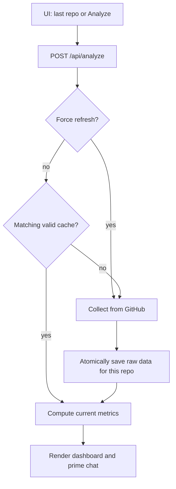

# Persist UI Repository Analysis - Plan

## Goal Capsule

- **Objective:** A returning visitor can reopen a previously analyzed GitHub repository in the UI without waiting for another GitHub scan, including after a page reload or server restart.
- **Means:** Store raw analysis data by repository on disk and let the UI reopen its last repository through the existing analysis API (KTD1, KTD3).
- **Authority:** The user's clarification that this concerns the UI. Existing API and metric behavior remain the compatibility baseline.
- **Execution profile:** Add integration coverage for a cache hit before changing the request path; verify the browser reload flow after the server path works.
- **Stop conditions:** Do not use a cache entry for another repository or serve an incomplete entry as a successful analysis.
- **Who finishes:** The implementer verifies and ships the code change; the user decides when to merge it.

---

## Product Contract

### Summary

Keep repository analysis available between UI visits. The next visit reuses saved GitHub data, while a deliberate refresh fetches new data.

### Problem Frame

The UI always posts `force_refresh: false` to `/api/analyze`, but `app.py` calls `collect_data` for every request and ignores that flag. Its in-memory metrics map supports chat during the current server process but cannot reopen analysis after a restart. The existing CLI cache is one `raw_data.json` file, which is not keyed by repository and is unsuitable for the UI's multi-repository history.

### Requirements

**Returning to a repository**

- R1. Reanalyzing a repository already viewed through the UI reuses its saved GitHub data without calling GitHub again, including after the server restarts.
- R2. Reloading the browser page reopens the last viewed repository and displays its dashboard without a fresh GitHub scan when saved data exists.
- R3. Repository A's saved data is never returned for repository B, regardless of how the repository was entered as a URL or slug.

**Freshness and recovery**

- R4. The UI offers a clear action to fetch fresh GitHub data for the displayed repository. A successful refresh replaces that repository's saved data without changing other repositories' entries.
- R5. A missing, unreadable, corrupt, or mismatched saved entry causes a normal collection for the requested repository. A failed collection must not replace a previously valid entry.
- R6. The UI distinguishes data loaded from saved collection from newly collected data and shows when GitHub data was captured.

### Key Decisions

- **UI repository revisit is the target** (session-settled: user-directed — chosen over a general CLI cache change: the user clarified that repeated scans in the UI are the problem). Governs R1, R2, R4, R6.

### Scope Boundaries

- The existing CLI `raw_data.json` workflow is outside this change. The UI's new repository cache must not read that file as a cross-repository cache.
- Saved GitHub data has no automatic expiration in this plan. The user controls freshness through R4; the capture time in R6 makes age visible.
- Previously cached data from the single `raw_data.json` file is not migrated because its repository association cannot be trusted without checking its contents.
- Account-wide history, cloud storage, and cache management screens are outside this change.

### Acceptance Examples

- AE1. Given the UI has analyzed `owner/alpha`, when the browser reloads and the last repository reopens, the dashboard appears and no GitHub query runs. Covers R1, R2.
- AE2. Given `owner/alpha` is cached, when the visitor opens `owner/beta`, only beta's matching cache entry may be used; a missing beta entry triggers collection. Covers R3.
- AE3. Given a saved analysis, when the visitor requests fresh data, GitHub is queried and the next ordinary visit uses the new capture. Covers R4, R6.
- AE4. Given an invalid saved entry, when the repository is opened, the API collects it and returns its metrics. Covers R5.

---

## Planning Contract

### Key Technical Decisions

- KTD1. **Persist raw data per normalized repository slug.** Put API cache files under an ignored local cache directory and derive their paths only from validated owner/repo components. Raw data preserves `captured_at`; metrics are computed on each request so age-dependent metrics use the current clock. This extends `compute_flow_metrics` without persisting its time-sensitive output.
- KTD2. **Keep the cache boundary in the API path.** `app._run_analysis` checks the repository cache unless `force_refresh` is true, then passes raw data to `compute_flow_metrics`. Leave `analyze.load_or_collect` and the CLI's legacy file behavior alone, per the UI scope decision governing R1 and R2.
- KTD3. **Remember only the last repository in the browser.** Store its normalized slug locally and request it through `/api/analyze` on page load. The server remains the source of analysis data; the browser does not duplicate the metrics payload.
- KTD4. **Use complete, atomic cache replacement.** Validate stored repo identity and raw-data shape before use. Distinguish a successful empty GitHub result from a transport failure before replacing a cache entry: current collection helpers swallow some query failures and return empty lists. A failed cache read is a miss; a failed cache write does not discard a successful response.
- KTD5. **Expose cache provenance in the API response.** Add a small additive field that tells the UI whether the request reused saved data. Keep existing metric fields and chat context intact; display `captured_at` already carried by the metrics payload.

### High-Level Technical Design

### System-Wide Impact

- The API retains its in-memory metrics map for `/api/chat`; every cache-backed `/api/analyze` request must repopulate that map so chat works after a server restart.
- The browser's saved last-repository slug is local to that browser. The repository data cache is local to the server filesystem; ephemeral hosting will lose it on deployment restart unless that filesystem is mounted persistently.
- `collect_data` currently also writes `raw_data.json`. The new API cache is independent of that side effect, and the plan does not make `raw_data.json` a source for UI cache hits.

---

## Implementation Units

### U1. Repository-scoped raw cache

- **Goal:** Reuse valid saved GitHub data for the requested repository and replace it safely on refresh.
- **Requirements:** R1, R3, R5.
- **Dependencies:** None.
- **Files:** `repository_cache.py` (new), `tests/unit/test_repository_cache.py` (new), `tests/integration/test_collect_data.py` (existing cache contract reference).
- **Approach:** Implement KTD1 and KTD4 as a small file cache around the existing raw bundle shape. Reject slugs that cannot safely form a repository identity or cache path. Keep the API cache separate from `raw_data.json`.
- **Patterns to follow:** `analyze.py` raw bundle keys and `tests/factories.py`'s `small_raw_data`; test isolation in `tests/conftest.py`.
- **Test scenarios:**
  - Save data for `owner/alpha`, load it from a new cache instance, and get the same raw bundle with no collection.
  - Save alpha and beta; loading either returns only its own bundle, including when input case and URL normalization are considered at the API boundary.
  - A cache file with a different `repo`, missing required collection fields, or invalid JSON is treated as a miss.
  - A failed replacement leaves the prior complete entry readable; path traversal shaped input cannot address files outside the cache directory.
- **Verification:** Repository identity and `captured_at` survive a process-level cache reopen; bad entries never produce a hit.

### U2. API cache use and explicit refresh

- **Goal:** Make repeated `/api/analyze` calls reuse saved data and honor `force_refresh`.
- **Requirements:** R1, R3, R4, R5, R6.
- **Dependencies:** U1.
- **Files:** `app.py`, `analyze.py`, `tests/integration/test_api.py`, `tests/integration/test_collect_data.py`, `tests/e2e/test_pipeline.py`.
- **Approach:** Route `_run_analysis` through U1, preserving current metric computation and `_metrics_cache` population. Expose enough collection failure status from `analyze.py` for KTD4 without changing the CLI's cache behavior. Normalize and validate repository identity before cache lookup. Return the KTD5 provenance field with the existing response shape.
- **Patterns to follow:** `_parse_repo_slug`, `compute_flow_metrics`, `tests/factories.py`'s `FakeGh`, and the existing `TestClient` route tests.
- **Test scenarios:**
  - Covers AE1. First request collects alpha; a later request after clearing in-memory metrics returns alpha from disk without invoking `gh`, and chat can use those metrics.
  - Covers AE2. A cached alpha never satisfies beta's request; beta collects and gets beta metrics.
  - Covers AE3. A request with `force_refresh: true` calls collection even on a cache hit, updates only alpha's cache, and the next ordinary request sees the new capture.
  - Covers AE4. A corrupt alpha entry triggers collection; a collection failure returns the current error response and does not publish partial data.
  - A GitHub query failure that currently yields an empty list does not overwrite an older valid cache entry; a genuinely empty result may be saved.
  - The response reports cache hit versus fresh collection without removing existing metric fields.
- **Verification:** The API makes no GitHub call for a valid cache hit and honors the refresh flag across server restarts.

### U3. UI reopen and freshness controls

- **Goal:** Reopen the last repository after page reload and let the visitor request current GitHub data.
- **Requirements:** R2, R4, R6.
- **Dependencies:** U2.
- **Files:** `index.html`, `tests/frontend/repository_restore.test.cjs` (new), `.github/workflows/ci.yml`, `README.md`.
- **Approach:** Remember the normalized slug after successful analysis. On page initialization, put it back in the input and request analysis; use the API's cache provenance and `captured_at` in status text. Add a visible refresh action that sends `force_refresh: true` for the current repository. Reuse the existing loading, error, and render paths so failed restores remain recoverable through the form.
- **Patterns to follow:** `analyzeRepo`, `showLoading`, `showStatus`, `renderDashboard`, and the existing API request shape in `index.html`. Use Node's built-in test and VM APIs to exercise the page script without launching Chromium; API integration tests prove the real cache boundary.
- **Test scenarios:**
  - Covers AE1. After a successful analysis, reloading the page restores the same repository and renders the dashboard from a cache-backed API response.
  - Covers AE3. The refresh control sends `force_refresh: true`, shows a fresh capture, and an ordinary subsequent load reports a cache hit.
  - Missing or unavailable browser storage leaves manual analysis usable; a failed automatic restore shows an error and does not trap the visitor in loading state.
- **Verification:** The page script restores the previous repository and sends a cache-backed request on simulated reload; the UI code makes the data's age and refresh option clear.

---

## Verification Contract

- Run the relevant unit and integration tests for the cache and API, then the full `pytest --cov` gate and `ruff check .` used by CI. Run the Node test for last-repository restore and refresh controls.
- Verify the combined page-script and server behavior: the Node test simulates reload and refresh; API integration tests reopen persisted data after clearing memory and confirm no new GitHub scan.
- Keep automated tests network-free using the existing `subprocess.run` guard and temporary working directory. The Node test intercepts API responses and does not launch Chromium.

---

## Definition of Done

- R1–R6 and AE1–AE4 are demonstrated by the unit, API, and Node UI checks above.
- A cache hit leaves GitHub untouched; force refresh collects and replaces one repository's entry; a bad entry cannot leak another repository's data.
- The README explains where the UI cache lives, how long data remains saved, how to refresh it, and the limitation of ephemeral server storage.
- The final diff contains no abandoned cache formats or experimental paths.
